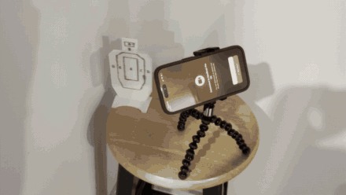
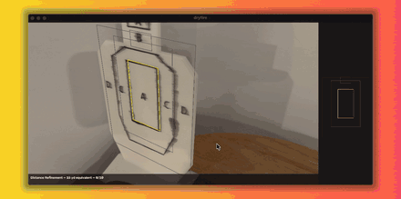

# opendryfire

[](https://github.com/aysark/opendryfire/actions/workflows/tests.yml)

Scores laser dry fire from a webcam and times it from the microphone. Any
firing-pin laser cartridge, no proprietary hardware, no subscription.

<p align="center">
  
  
</p>

Point a camera at a target, put a laser cartridge in your **unloaded** pistol,
and it records where each shot landed and how long the draw took. It understands
**scaled targets**: a 1/5-scale target at 9 feet reports groups in
15-yard-equivalent inches, so numbers from your basement compare to the range.

## Safety

**This scores dry fire. It does not make dry fire safe.** Nothing in this
program verifies that a firearm is unloaded, and no feature should be read as if
it does. That is entirely on you, every single time.

**The four rules:**

1. Treat every firearm as if it is loaded.
2. Never let the muzzle cover anything you are not willing to destroy.
3. Keep your finger off the trigger until your sights are on target and you have
   decided to fire.
4. Be sure of your target and what is beyond it.

**For a dry fire session, additionally:**

- **All live ammunition leaves the room** — not the bench, the room. Magazines
  too.
- **Verify the chamber visually *and* physically.** Look, then feel with a
  finger.
- **Aim at a real backstop:** a concrete wall, a full bookcase, an exterior wall
  with nothing behind it. Something that would actually stop a round.
- **The reload after practice is where negligent discharges happen**, not during
  it. Announce to yourself out loud that the session is over before ammunition
  comes back in the room.
- Never point the muzzle at the camera, and never stand downrange of it.

## Install

Python 3.12+ and [uv](https://docs.astral.sh/uv/).

```bash
git clone https://github.com/aysark/opendryfire && cd opendryfire
uv sync
```

The package is `opendryfire`; the command is `dryfire`. macOS prompts for camera
and microphone access on first run — both are required.

## Quick start

```bash
uv run dryfire probe                   # what cameras and mics exist
uv run dryfire use-camera iphone       # pick one by name
uv run dryfire calibrate --setup f-15  # click the four A-zone corners
uv run dryfire autocal                 # measure the room, set thresholds
uv run dryfire spike                   # fire ~10 shots; measures your laser
uv run dryfire autocal                 # again, now sized to the real dot
uv run dryfire audiocal                # separate clicks from room noise
uv run dryfire run F15                 # go
uv run dryfire report                  # what previous sessions said
```

Order matters. `calibrate` first, so thresholds are measured against the target
plane rather than the whole room. `autocal` twice is deliberate: the first pass
gives `spike` thresholds to detect with, `spike` measures how big your laser
actually is, and the second pass sizes the detector's limits to that measurement
instead of assuming. It will tell you which it did.

**Camera placement:** two to four feet from the target, off to one side —
**never** downrange or in the muzzle line. Perspective is removed
mathematically, so an oblique view costs nothing. Keep bright red things out of
frame; a charger LED is nearly as red as a 635nm laser, and `autocal` will say
so and point at it.

## How it works

**The microphone answers *when*. The camera answers *where*.**

The start beep is played *and recorded on the same stream* as the striker click:

    draw_time = (click_sample − beep_sample) / 48000

Output latency, input latency and USB jitter cancel, because they apply to both
events equally. Video timestamps are never used for timing — consumer webcams
cap near 30fps, which quantises a video-derived time to 33ms before the driver's
pipeline delay is even counted.

Position comes from a homography clicked off the target's **own** A-zone, so the
reference points sit in the same plane as the surface being scored. Markers on a
board behind a standing target do not, and skew every hit by about 0.3″ —
invisible in the output.

Every shot needs **both** a flash and a click within 150ms. Click with no flash
is a slide rack; flash with no click is a reflection, discarded. That fusion is
what makes this work in an ordinary room.

## Plans

What you run is a TOML file, not code. `dryfire plan` shows the active one.

```toml
[[setups]]
key = "f-15"
target = "uspsa"           # or "b8"
scale_denominator = 5      # 1/5 scale
stand_distance_ft = 9.0    # → 15 yd equivalent, derived

[[blocks]]
key = "F15"
name = "Distance Refinement"
setup = "f-15"
timed = false
reps = 10
```

Save yours as `~/.dryfire/plan.toml` or pass `--plan`. Blocks are timed (with an
optional par ladder that tightens as you go clean) or untimed. Targets built in:
USPSA/IPSC Metric and NRA B-8, both defined in real inches at full scale.

Sessions land in `~/.dryfire/sessions/` as JSON; `dryfire vault ~/notes` adds
Markdown export with group size, hit count and group shape classified to a fix.

## Hardware

**Cartridge.** Any firing-pin-activated laser cartridge. The property that
matters is **pulse length**: ~100ms gives 3 frames at 30fps. Some cartridges
flash for ~1ms and a camera will miss most of those — a hardware limit no
software fixes, so check before buying. Tuned for red 635-650nm.

**Camera.** Anything OpenCV can open, addressed by *name* rather than index. If
you use an iPhone, Center Stage is disabled per session automatically — it pans
and crops to follow people, which silently invalidates a calibration.

**Microphone.** Any. `audiocal` places the threshold between your room noise and
your striker click, and says so plainly if the two overlap.

## Known limits

- **Multi-shot strings are not true splits.** A striker-fired pistol is dead
  until the slide is cycled, so a laser-scored string is one shot per rack. Rack
  time is measured separately. Physics, not a bug.
- **Only the break is visible.** The laser is off while you aim, so one shot
  cannot show how far you dipped. Read group *shape* over ten instead.
- **Manual exposure is often unavailable** on macOS built-in and Continuity
  cameras. Compensated with red-dominance testing and a target-plane mask.
- **macOS-first.** CI runs the full suite on Linux, so detection, geometry,
  scoring and audio are known to work there. What has not happened elsewhere is
  a real session against real hardware, which is where camera quirks live.

## Development

```bash
uv run pytest src/tests -q     # 185 tests, no hardware required
```

Synthetic frames and synthesised audio, modelling the awkward cases on purpose:
a dot whose core is blown to white with red only in its halo, a dropped frame
mid-pulse, a cream target on warm red-dominant wood, a striker click as a
broadband burst over room tone.

`docs/DESIGN.md` records why each threshold is what it is, including the
approaches that were killed and the measurements that killed them — read the
relevant section before changing a constant. [CONTRIBUTING.md](CONTRIBUTING.md)
has the rest; two rules carry most of the weight: measure rather than guess, and
fail loudly rather than plausibly, because a wrong number that looks reasonable
corrupts a training log for months.

Bug reports are far more useful with `dryfire probe`, `autocal` and `audiocal`
output attached — most detection problems are a room, not a bug, and those
commands say which.

## License

Apache-2.0. The copyright notice, the licence and the contents of `NOTICE`
travel with the code and with any derivative work.
